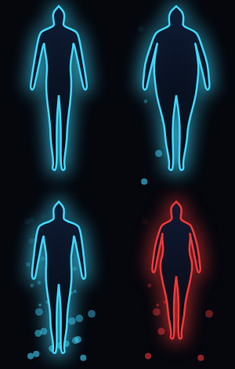

# AriseUp

> *[Has cumplido los requisitos para convertirte en Jugador. ¿Aceptas?]*

App Android que convierte tu entrenamiento y tu dieta en el **Sistema** de un cazador: misiones diarias, XP, niveles, rangos de E a S, stats y una **Zona de Penalización** que castiga de verdad si fallas.

## Funciones

- **Misión diaria** al estilo del Sistema (flexiones, abdominales, sentadillas y correr), calibrada con un test inicial y que escala con tu nivel.
- **Rutinas personalizadas** y **misiones urgentes** que el Sistema lanza por sorpresa.
- **Penalización**: si fallas una misión obligatoria, tienes que cumplir un entreno más duro; si lo ignoras, pierdes XP, stats y hasta niveles.
- **Dieta estilo MyFitnessPal**: escáner de códigos de barras, búsqueda en Open Food Facts, tabla de alimentos genéricos en español y recetas.
- **Silueta del Jugador** que cambia con tu peso y tu fuerza reales.
- **Estado de descanso** para vacaciones, enfermedad o lesión.
- Todo **local**: tus datos solo están en tu móvil (con copia de seguridad en JSON).

## Capturas



## Instalación

Descarga el APK de la última versión en [Releases](https://github.com/AdellEdgar/AriseUp/releases) e instálalo en tu Android (8.0 o superior).

## Desarrollo

Requiere JDK 17+ y el Android SDK (API 37).

- `domain/`: reglas del juego en Kotlin puro, con tests de JUnit 5 y de propiedades.
- `app/`: Jetpack Compose, Room, WorkManager, Ktor (Open Food Facts), CameraX + ML Kit y Health Connect.
- `tools/generic_foods/`: script que genera la tabla de alimentos genéricos.
- `docs/superpowers/`: especificación de diseño y plan de implementación.

```bash
./gradlew check assembleDebug
```

## Avisos

- **No es consejo médico.** Consulta a un profesional antes de empezar un plan de ejercicio o dieta.
- Proyecto de fan **sin afiliación** con *Solo Leveling* ni con sus titulares. No incluye imágenes, sonidos ni personajes de la obra.
- Datos de alimentos: [Open Food Facts](https://openfoodfacts.org) (ODbL) y USDA FoodData Central (dominio público).

## Licencia

MIT
